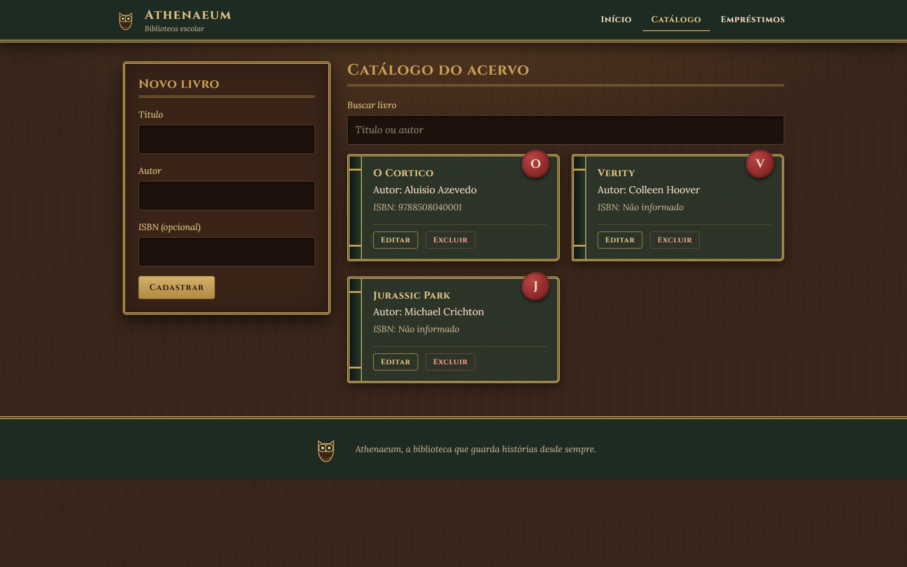

# TrabalhoBiblioteca

REST API built with Express.js to manage a school library: books, copies, readers, loans and book ratings. The repository also holds the React front-end that consumes this API.

**Team:** Sergio Horta da Silva Júnior and Jean Lucas de Alencar Santana
**Theme:** Library and book loans (PTAS 3)

## Problem

Small school libraries usually track loans in spreadsheets, which causes loss of control over overdue books, fines and the real availability of each copy. Students and teachers also follow different rules (quantity and period). This API lets the librarian manage books, copies, readers and loans while applying those rules automatically, and lets readers rate the books they have already returned.

## Repository structure

```
TrabalhoBiblioteca/
├── backend/    Express API + MongoDB (Docker)
├── frontend/   React (Vite) front-end that consumes the API
└── README.md
```

Each folder has its own `package.json`, so install and run the commands from inside the folder.

## Front-end (PTAC4)

**App:** Athenaeum, a library catalog.
**Front-end author:** Sergio Horta da Silva Júnior and Jean Lucas de Alencar Santana.
**Theme:** it manages the library's books (title, author and ISBN) and consumes the `/livros` resource of the Express API in this repository.

**API option:** A (own Express API, from the PTAS3 project). The API is included in this repository, in the `backend/` folder. Base URL: `http://localhost:3000`, set in `frontend/src/api.js`.

### Book fields

| Field | Type | Notes |
|---|---|---|
| `_id` | string | MongoDB ObjectId (24 hex characters), generated by the database |
| `titulo` | string | Required |
| `autor` | string | Required |
| `isbn` | string | Optional, must be unique |

### Routes used by the front-end

| Method | Route | Feature | Success |
|---|---|---|---|
| GET | `/livros` | List books | 200, array of books |
| POST | `/livros` | Create a book | 201, the created book |
| PUT | `/livros/:id` | Edit a book | 200, the updated book |
| DELETE | `/livros/:id` | Delete a book | 204, no body |

Errors come as `{ "erro": "message" }` (for example `409` when the ISBN already exists or when deleting a book that has copies), and the front-end shows that message in the page.

The real API differs from the generic contract in the assignment (no `/api/v1` prefix, lists as a plain array and errors in the `erro` field). All the adaptation lives in `frontend/src/api.js`, the only file that calls `fetch`.

### Features

- List with loading, error and empty states, and `AbortController` on the first request
- Controlled form with validation (no request is sent with empty required fields)
- Edit (the form switches to `PUT`, with a Cancel button) and delete
- Client-side search by title or author (no new request)
- Tabs: Home, Catalog and Loan rules

### Running the tests

```bash
cd frontend
npm install
npm test
```

20 tests with Vitest and React Testing Library: unit tests of the pure functions (`validarLivro`, `filtrarLivros`, `extrairLista`, including `toThrow`) and component tests (`CartaoLivro`, `FormularioLivro`) that never call the API.

### NoSQL vs SQL

One real document from the response of `GET /livros`:

```json
{
  "_id": "6afde91fd828fca6c6598296",
  "titulo": "O Cortico",
  "autor": "Aluisio Azevedo",
  "isbn": "9788508040001"
}
```

MongoDB stores data as documents, which are JSON-like objects: the one above is a single book. Documents are grouped in a collection (here, `livros`), which plays the role of a table in SQL, but the documents of a collection do not need to share the same fields. Each document has an `_id` generated by MongoDB, an ObjectId written as a string of 24 hexadecimal characters, while SQL databases (and JSONPlaceholder) usually use a numeric `id` that auto-increments (1, 2, 3, ...). Because the `_id` is a string and not a number, the front-end uses `livro._id` as the React `key` and in URLs such as `/livros/:id`.

### Screenshots




## Requirements

- Node.js 20.19 or higher (tested with v24)
- Express 5.x (`npm list express`, inside `backend/`)
- Docker (runs the MongoDB container)

## How to run

### API (`backend/`)

1. Enter the folder: `cd backend`
2. Copy the environment file: `Copy-Item .env.example .env` (PowerShell) or `cp .env.example .env`
3. Install the dependencies: `npm install`
4. Start the database (MongoDB in Docker): `npm run db:up`
5. Start the server: `npm start`

The server runs at `http://localhost:3000`. Example requests are available in `backend/requests.http`.

Other scripts: `npm run dev` (restarts on file changes), `npm run db:down` (stops the container), `npm run db:reset` (removes the container and its data).

### Front-end (`frontend/`)

With the API running, in another terminal:

1. Enter the folder: `cd frontend`
2. Install the dependencies: `npm install`
3. Start the app: `npm run dev`

The app runs at `http://localhost:5173`.

## Project structure (backend)

The code is organized in layers:

```
backend/src/
├── app.js            Express app: middlewares, routes and error handler
├── server.js         Connects to MongoDB and starts the server
├── config/           Database connection
├── routes/           Maps method + URL to a controller
├── controllers/      Read the request and build the response (no business rules)
├── services/         Business rules and validations
├── models/           MongoDB access (one collection per entity)
├── middlewares/      Request logger and centralized error handler
└── errors/           AppError class (message + HTTP status)
```

Flow of a request: `route -> controller -> service -> model -> MongoDB`. Errors thrown by the services (`AppError`) are converted to HTTP responses by the error handler.


## Entities

- **livros:** book data (title, author, ISBN)
- **exemplares:** physical copies of a book (`tombo`, state: `disponivel`, `emprestado`, `manutencao`)
- **leitores:** readers (name, registration, profile: `aluno` or `professor`)
- **emprestimos:** loans linking a reader and a copy (status: `ativo` or `devolvido`)
- **avaliacoes:** ratings of a book by a reader (grade from 1 to 5 and comment)

Full CRUD: livros, exemplares and leitores. A book can have many copies, a copy can have many loans, and a reader can have many loans and ratings. A loan is for a specific copy, but availability and ratings belong to the book.

All ids are MongoDB ObjectId strings.

## Endpoints

### Livros

| Method | Route | Description |
|---|---|---|
| GET | `/livros` | List books (filter `?titulo=`) |
| GET | `/livros/:id` | Get a book |
| POST | `/livros` | Create a book (`titulo` and `autor` required, unique `isbn`) |
| PUT | `/livros/:id` | Update a book |
| DELETE | `/livros/:id` | Delete a book (blocked if it has copies) |
| GET | `/livros/:id/disponibilidade` | Total and available copies |
| POST | `/livros/:id/avaliacoes` | Rate a book (`leitorId`, `nota` from 1 to 5, optional `comentario`) |
| GET | `/livros/:id/avaliacoes` | List the ratings of a book with the total and the average grade |

### Exemplares

| Method | Route | Description |
|---|---|---|
| GET | `/exemplares` | List copies (filter `?livroId=`) |
| GET | `/exemplares/:id` | Get a copy |
| POST | `/exemplares` | Create a copy (`livroId` and unique `tombo`) |
| PUT | `/exemplares/:id` | Update `tombo` or `estado` |
| DELETE | `/exemplares/:id` | Delete a copy (blocked if borrowed) |

### Leitores

| Method | Route | Description |
|---|---|---|
| GET | `/leitores` | List readers (filter `?perfil=`) |
| GET | `/leitores/:id` | Get a reader |
| POST | `/leitores` | Create a reader (`nome`, unique `matricula`, `perfil`) |
| PUT | `/leitores/:id` | Update a reader |
| DELETE | `/leitores/:id` | Delete a reader (blocked if active loans) |
| GET | `/leitores/:id/historico` | Loan history of a reader |

### Emprestimos

| Method | Route | Description |
|---|---|---|
| GET | `/emprestimos` | List loans (filter `?status=`) |
| GET | `/emprestimos/:id` | Get a loan |
| POST | `/emprestimos` | Create a loan (`leitorId` and `exemplarId`) |
| PATCH | `/emprestimos/:id/devolucao` | Return a loan: frees the copy and calculates the fine |
| PATCH | `/emprestimos/:id/renovacao` | Renew a loan: extends the due date |

Example body for `POST /emprestimos`:

```json
{ "leitorId": "66f1a2b3c4d5e6f7a8b9c0d1", "exemplarId": "66f1a2b3c4d5e6f7a8b9c0d2" }
```

Example body for `POST /livros/:id/avaliacoes`:

```json
{ "leitorId": "66f1a2b3c4d5e6f7a8b9c0d1", "nota": 5, "comentario": "Great book" }
```

Example response of `PATCH /emprestimos/:id/devolucao` for a loan returned 4 days late:

```json
{
  "status": "devolvido",
  "diasAtraso": 4,
  "multa": 2
}
```


## Business rules

1. **Loan limit by profile:** students can have up to 3 active loans (7 days) and teachers up to 5 (15 days). Example: a student with 3 active loans trying to borrow a fourth gets `409`.
2. **Block by overdue loan and fine:** a reader with an overdue loan cannot borrow new books nor renew. The fine is R$ 0.50 per day of delay (any started day counts) and is calculated on return. Example: a book returned 3.5 days after the due date counts 4 days and generates a fine of R$ 2.00.
3. **Renewal:** extends the due date by the period of the reader profile (7 days for students, 15 for teachers). It is blocked for readers with overdue loans (`403`) and limited to 1 renewal per loan (`409`).
4. **Ratings:** only a reader who already returned a copy of the book can rate it (`403`), each reader rates each book only once (`409`) and the grade must be an integer from 1 to 5 (`400`).
5. **Book versus copy:** the loan is for a specific copy, but availability and ratings belong to the book. A copy can only be borrowed when its state is `disponivel`.

## Error format and status codes

Every error returns a JSON body in the format `{ "erro": "message" }`.

| Status | Meaning |
|---|---|
| 200 | Success |
| 201 | Resource created |
| 204 | Deleted, no content |
| 400 | Invalid or missing data (or malformed JSON) |
| 403 | Operation blocked by a business rule (for example, overdue loan) |
| 404 | Resource or route not found |
| 409 | Conflict (limit reached, duplicate value, copy unavailable) |
| 500 | Unexpected internal error |

## Optional resources

CORS is enabled so a front-end served from another origin can consume the API.